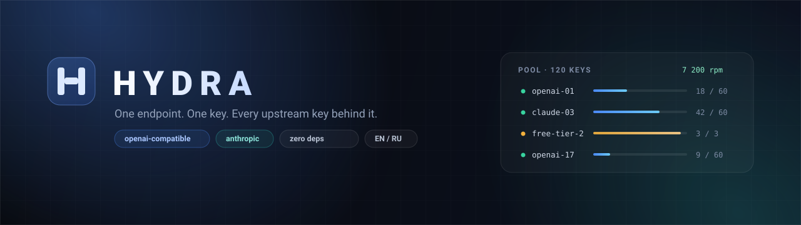
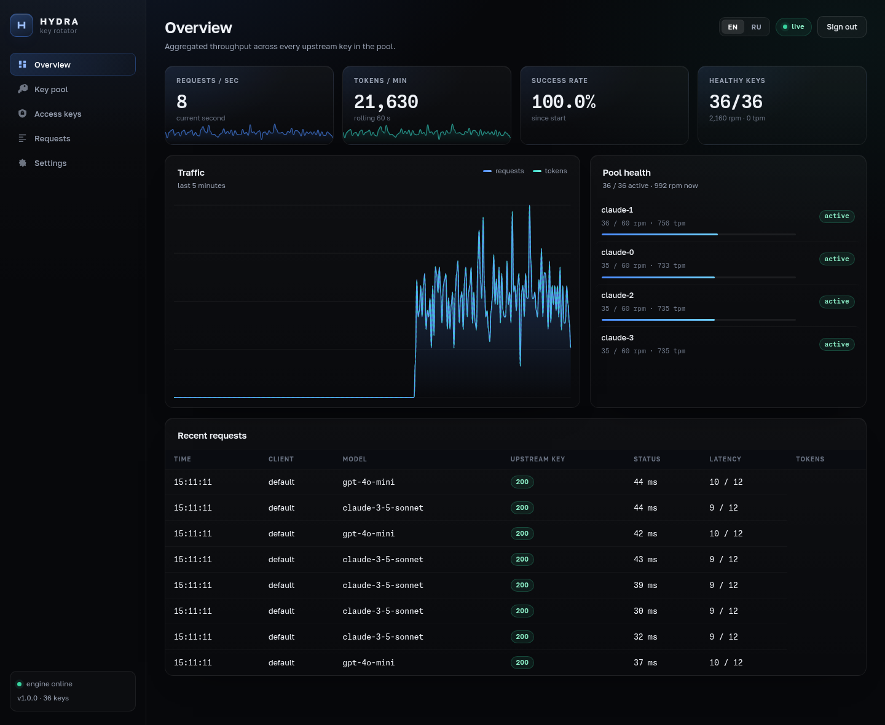
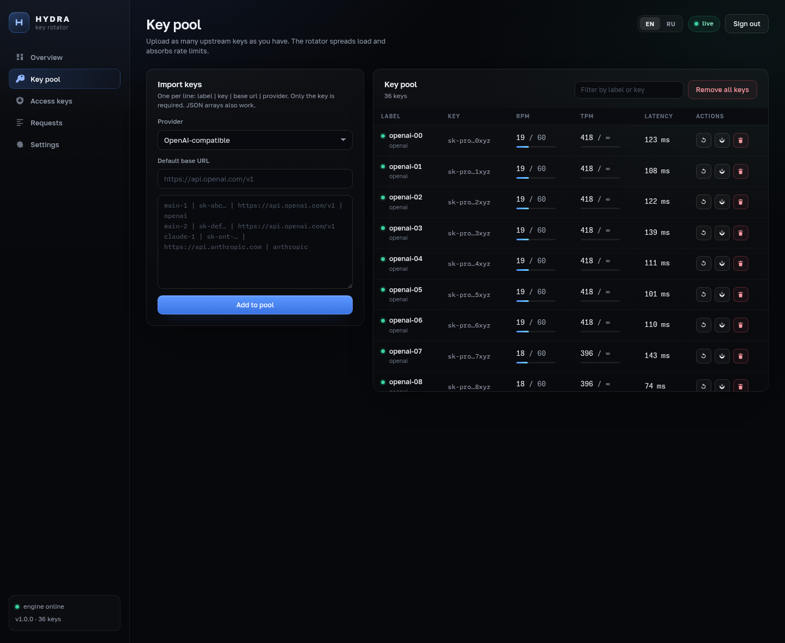
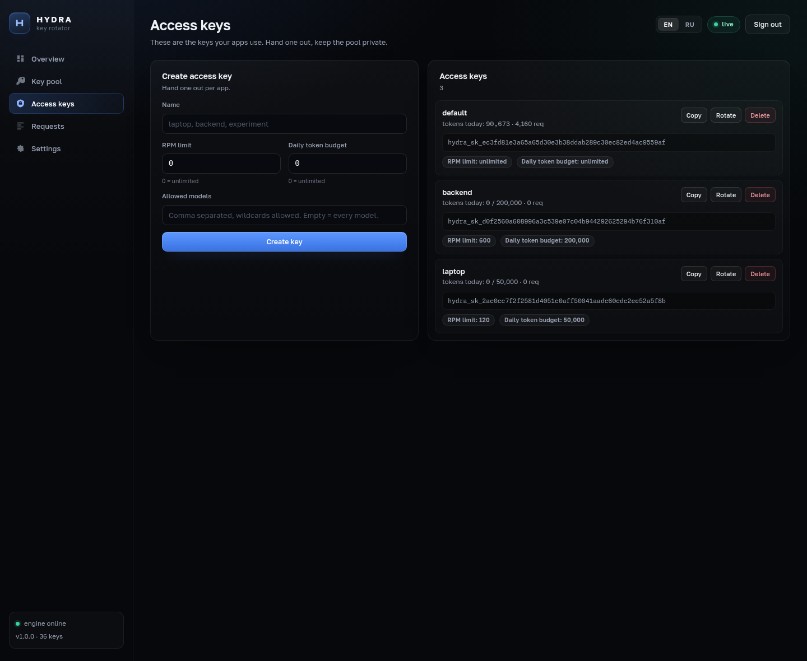
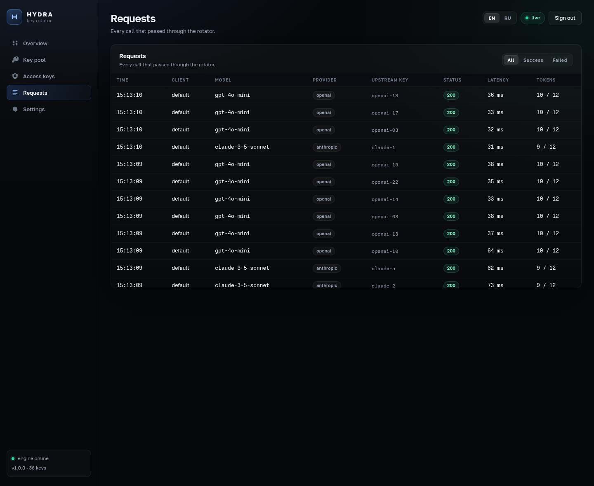
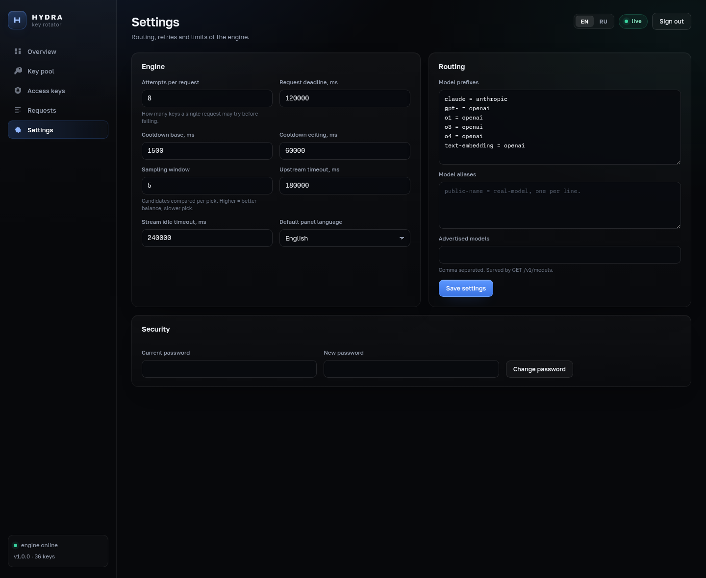
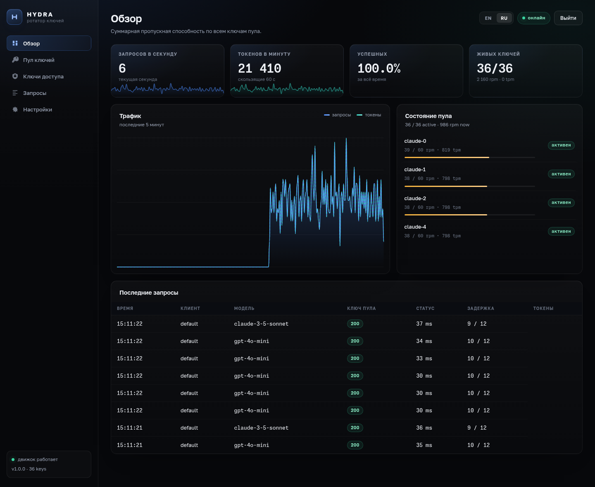
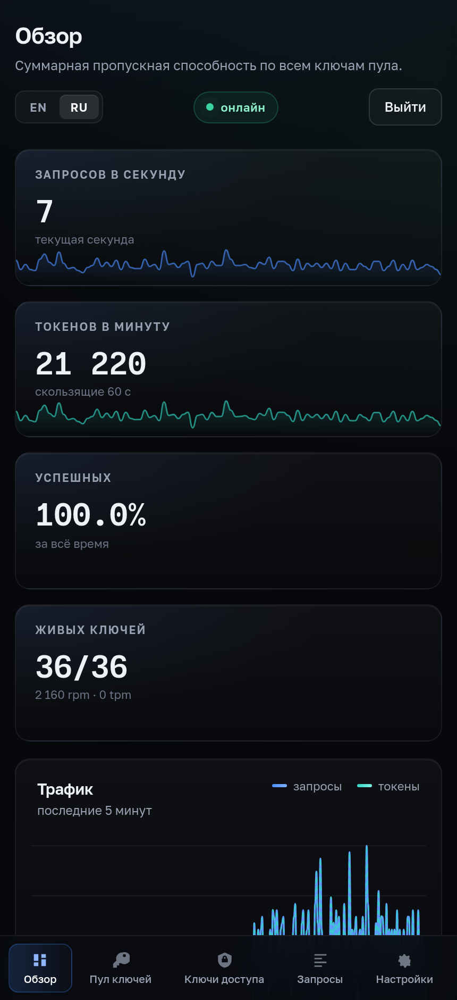
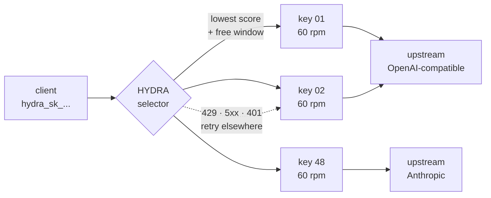

<p align="center">
  
</p>

<p align="center">
  <a href="LICENSE"></a>
  
  
  
  
  <a href="https://github.com/hydradevc/rotation/actions/workflows/ci.yml"></a>
</p>

<h3 align="center">A hundred API keys in. One endpoint out.</h3>

<p align="center">
  Paste a pile of OpenAI-compatible and Anthropic keys into the panel, get a single key that behaves
  like the sum of all of them. Rate limits land on the pool instead of on you.
</p>

<p align="center">
  
</p>

---

## The problem

You have 100 keys. Each one gives you 60 requests per minute and some token budget.
A single key is a bottleneck, and rotating by hand turns into a wall of `429`s.

## The answer

HYDRA keeps every key in a live pool and picks one per request. If a key answers `429`, `5xx`
or dies on auth, the request silently moves to the next key — your client still sees a `200`.
The ceiling becomes the sum of the pool: **100 keys × 60 RPM = 6,000 RPM** on a single key.

| Without HYDRA | With HYDRA |
|---|---|
| 1 key → 60 RPM, hard wall | 100 keys → 6,000 RPM, one key to hand out |
| `429` reaches your app | `429` is absorbed and retried on another key |
| Manual key shuffling in code | Keys are ranked by live load and free window |
| OpenAI and Anthropic = two integrations | One endpoint speaks both shapes |

## Features

| | |
|---|---|
| **Pooled throughput** | Every upstream key contributes its own RPM and TPM. The pool is the limit, not the key. |
| **Load-aware selection** | Power-of-two choices over sampled candidates; score mixes in-flight requests, weight, RPM/TPM pressure and recent failures. |
| **Rate-limit absorption** | Per-key 60-second windows for requests *and* tokens, reservations before the call, `Retry-After` / `x-ratelimit-reset-*` aware exponential cooldown. |
| **Both API shapes** | Native OpenAI and Anthropic endpoints. Mixed pools work: ask with `/v1/messages`, get served by an OpenAI key — and the other way round. |
| **Streaming that stays streaming** | Native SSE is piped byte by byte, no buffering, no re-serialisation. Cross-format streams are emitted as proper SSE for the client's format. |
| **Access keys** | Give each app its own key with its own RPM ceiling, daily token budget and model allow-list. Revoke or rotate without touching the pool. |
| **Zero dependencies** | Pure Node ≥ 20. No build step, no `node_modules`, no container required. |
| **Panel in two languages** | Full English and Russian UI, dark, keyboard-friendly, live metrics once per second. |
| **Single-file state** | `data/state.json`, atomic writes. Copy the file to move the whole pool. |
| **Probing** | Test any key against its upstream from the panel and see status and latency immediately. |

## Quick start

```bash
git clone https://github.com/hydradevc/rotation.git
cd rotation
node server.js
```

First start prints the admin password once and creates your first access key:

```
┌─────────────────────────────────────────────┐
│  HYDRA admin password (save it now)         │
│  xxxxxxxxxxxx                               │
└─────────────────────────────────────────────┘
HYDRA rotator listening on http://0.0.0.0:8080
  admin panel    http://localhost:8080/admin
  openai base    http://localhost:8080/v1
  anthropic base http://localhost:8080
  Default access key created:
  hydra_sk_....
```

Open `http://localhost:8080/admin`, go to **Key pool**, paste your keys, done.
No `npm install` — there is nothing to install.

> Runs on Android/Termux as well: `pkg install nodejs`, then `node server.js`.

## Connect a client

**OpenAI SDK (Python)**

```python
from openai import OpenAI

client = OpenAI(base_url="http://localhost:8080/v1", api_key="hydra_sk_...")

print(client.chat.completions.create(
    model="gpt-4o-mini",
    messages=[{"role": "user", "content": "hello"}],
).choices[0].message.content)
```

**OpenAI SDK (JavaScript)**

```js
import OpenAI from 'openai';

const client = new OpenAI({ baseURL: 'http://localhost:8080/v1', apiKey: 'hydra_sk_...' });
```

**Anthropic SDK (Python)**

```python
from anthropic import Anthropic

client = Anthropic(base_url="http://localhost:8080", api_key="hydra_sk_...")

print(client.messages.create(
    model="claude-3-5-sonnet",
    max_tokens=128,
    messages=[{"role": "user", "content": "hello"}],
).content[0].text)
```

**curl**

```bash
curl http://localhost:8080/v1/chat/completions \
  -H "Authorization: Bearer hydra_sk_..." \
  -H "Content-Type: application/json" \
  -d '{"model":"gpt-4o-mini","messages":[{"role":"user","content":"hello"}]}'
```

Any OpenAI-compatible client works — OpenWebUI, SillyTavern, Cline, LibreChat, LiteLLM —
just point the base URL at HYDRA.

## The panel

<table>
  <tr>
    <td width="50%"></td>
    <td width="50%"></td>
  </tr>
  <tr>
    <td></td>
    <td></td>
  </tr>
</table>

<p align="center">
  
  
</p>

## How a request flows



Per request, in order:

1. Authenticate the access key, check its RPM window, daily token budget and model allow-list.
2. Route the model to a provider (`claude*` → Anthropic, `gpt-*`/`o*` → OpenAI) — configurable by prefix.
3. Pick a key: candidates are filtered by status, cooldown and provider, then a sample of them is
   scored by `(inflight + 1) / weight × (1 + rpm_pressure + tpm_pressure) + failures`.
4. Reserve RPM and estimated tokens on that key, call the upstream.
5. `429`/`5xx`/auth error → cooldown that key with backoff and retry the next candidate.
   `4xx` caused by the request itself is returned to the client untouched.
6. Stream the body straight back, then settle real token usage into the key's window.

## Importing keys

Paste one key per line. Everything except the key is optional:

```
# label | key | base url | provider
main-1   | sk-proj-...      | https://api.openai.com/v1
main-2   | sk-proj-...
claude-1 | sk-ant-...       | https://api.anthropic.com | anthropic
groq-1   | gsk_...          | https://api.groq.com/openai/v1
```

Flat lists and JSON arrays also work:

```json
[{ "label": "main-1", "key": "sk-...", "provider": "openai", "baseUrl": "https://api.openai.com/v1" }]
```

Defaults per key: 60 RPM, unlimited TPM, weight 1. Edit both from the panel — a key with a higher
weight takes proportionally more traffic.

## Endpoints

| Method | Path | Description |
|---|---|---|
| `POST` | `/v1/chat/completions` | OpenAI chat completions, streaming included |
| `POST` | `/v1/embeddings` | OpenAI embeddings |
| `POST` | `/v1/messages` | Anthropic messages, streaming included |
| `POST` | `/v1/messages/count_tokens` | Anthropic token counting |
| `GET` | `/v1/models` | Models advertised in settings |
| `GET` | `/healthz` | Liveness with key count and uptime |
| `GET` | `/admin` | Admin panel |

Auth: `Authorization: Bearer hydra_sk_...` or `x-api-key: hydra_sk_...`.

## Tuning

All of it lives in **Settings** in the panel.

| Setting | Default | What it does |
|---|---|---|
| Attempts per request | 8 | How many different keys one request may try |
| Request deadline | 120,000 ms | Give up and answer after this long |
| Cooldown base | 1,500 ms | First backoff after a `429` |
| Cooldown ceiling | 60,000 ms | Cap for exponential backoff |
| Sampling window | 5 | Candidates compared per pick (higher = smoother, slower) |
| Upstream timeout | 180,000 ms | Time allowed for upstream headers |
| Stream idle timeout | 240,000 ms | Abort a stream that stops producing |

## Tests

```bash
npm test          # 26 checks against a local mock upstream
npm run test:ui   # drives the real panel in headless Chromium
npm run bench     # 100 keys, 2,000 requests
```

What `npm test` covers: bulk import, concurrent fan-out across keys, `429` absorption against a
6×5 RPM ceiling, saturation behaviour, SSE streaming, native Anthropic calls, cross-format routing
both ways, failover from a dead key, token accounting and the request log.

## Project layout

```
server.js            http server, static files, routes
src/store.js         state, persistence, metrics buckets
src/pool.js          rate windows, scoring, cooldowns
src/proxy.js         upstream calls, retries, streaming
src/translate.js     OpenAI ⇄ Anthropic translation
src/admin.js         sessions, admin API
public/              panel (vanilla JS, no framework, no build)
test/                mock upstream, integration, UI and bench harnesses
```

## Roadmap

- Sticky routing by prompt hash for cache-friendly providers
- Per-model cost weighting in the selector
- Prometheus `/metrics` endpoint
- Dockerfile and a one-command compose file

## License

MIT — see [LICENSE](LICENSE).

---

<details>
<summary><b>🇷🇺 Русская версия — коротко</b></summary>

<br>

**HYDRA** — самохостящийся ротатор ключей для ИИ-API. Загружаете пачку ключей
OpenAI-совместимых и Anthropic, на выходе один ключ, который ведёт себя как сумма всех.

```bash
git clone https://github.com/hydradevc/rotation.git
cd rotation
node server.js        # зависимостей нет, npm install не нужен
```

При первом запуске в консоль печатается пароль админки и создаётся первый ключ доступа.
Панель: `http://localhost:8080/admin`. Ключи вставляются пачкой на вкладке **Пул ключей**,
по строке на ключ: `метка | ключ | адрес | провайдер` — обязателен только ключ.

Клиенты подключаются так:

- OpenAI-совместимые: base URL `http://localhost:8080/v1`, ключ `hydra_sk_...`
- Anthropic SDK: base URL `http://localhost:8080`, тот же ключ

Что внутри: секундные окна RPM/TPM на каждый ключ, выбор по текущей загрузке,
переключение на другой ключ при `429`/`5xx`/`401`, честный стриминг без буферизации,
трансляция форматов в обе стороны, ключи доступа с лимитами, панель на русском и английском.

Тесты: `npm test` (26 проверок), `npm run test:ui`, `npm run bench`.

</details>